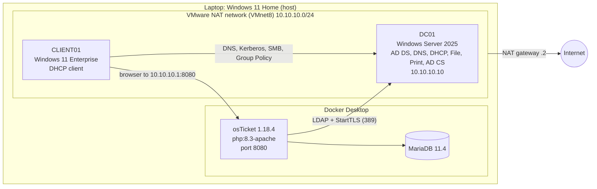

# Help Desk-in-a-Box: Active Directory + osTicket Home Lab

A help desk home lab for a fictional 25-person Hamilton manufacturer. It has a Windows Server 2025 domain, a Windows 11 workstation and an osTicket help desk that staff sign in to with their Active Directory accounts. I worked through realistic support tickets in it and documented each one from report to resolution.

> **Status:** 🚧 In progress. Phases and checkboxes are in [RUNBOOK.md](RUNBOOK.md).
> **Lab, not production:** this is home-lab practice on evaluation licences, not a workplace environment.

---

## Scenario

**Bayview Precision Fabrication Ltd.** is a fictional metal fabrication shop in Hamilton, ON, with about 25 staff in four departments: Office/Admin, Production, Shipping & Receiving, and Management. I'm the one-person IT team. Staff report problems through the help desk portal, and I triage, fix, document and close each ticket.

## What this lab demonstrates

| Area | What I built or did |
|---|---|
| Active Directory | New forest `bayview.internal`, an OU design, users, security groups, a separate admin account, a service account |
| Group Policy | Password and lockout policy, mapped drives, printer deployment, software deployment (MSI), screen-lock policy |
| Core services | DNS (forwarders, reverse zone), DHCP (scope and options), file shares with NTFS permissions, print server |
| Certificates | Enterprise root CA (AD CS); the domain controller certificate enables secure LDAP (StartTLS) |
| Ticketing | osTicket 1.18 with departments, help topics, SLA plans and canned responses |
| Integration | osTicket staff and end users sign in with their AD accounts (LDAP plugin over TLS) |
| Containers | osTicket on the official `php:8.3-apache` image with a MariaDB 11.4 database, via Docker Compose |
| Troubleshooting | 10 documented tickets: lockouts, resets, permissions, drive maps, printers, DNS, software, LDAP |

## Topology



## Environment

| Machine | Role | OS | vCPU / RAM / Disk (thin) | IP |
|---|---|---|---|---|
| DC01 | Domain controller, DNS, DHCP, file and print server, certificate authority | Windows Server 2025 Standard Evaluation (Desktop Experience) | 2 / 4 GB / 60 GB | 10.10.10.10 (static) |
| CLIENT01 | Staff workstation | Windows 11 Enterprise Evaluation | 2 / 4 GB / 64 GB | DHCP (.100–.199) |
| osTicket stack | Help desk | Docker Desktop on the host (`php:8.3-apache` + `mariadb:11.4`) | n/a | Host VMnet8 IP 10.10.10.1, port 8080 |

**Virtualization:** VMware Workstation Pro on an ASUS TUF A15 (Ryzen 7 6800H, 16 GB RAM).

## Active Directory design

```
bayview.internal
└── Bayview
    ├── Users
    │   ├── Office
    │   ├── Production
    │   ├── Shipping
    │   ├── Management
    │   └── IT
    ├── Computers
    │   └── Workstations
    ├── Groups
    ├── Service Accounts
    ├── Admin Accounts
    └── Disabled Users
```

- **Security groups:** `GG-Office`, `GG-Production`, `GG-Shipping`, `GG-Management`, `GG-IT`
- **Admin model:** `emignardi` is my everyday account. `adm-emignardi` is a separate Domain Admin account used only for admin work.
- **Service account:** `svc-osticket` is a standard user that osTicket uses only to search the directory.

## Group Policy

| GPO | Linked to | Does |
|---|---|---|
| Default Domain Policy (edited) | Domain | 12-character complex passwords, lockout after 5 bad attempts for 15 minutes |
| BAY-U-DriveMaps | Bayview\Users | S: → `\\DC01\Company`, M: → `\\DC01\Company\Management` (Management only) |
| BAY-U-Printers | Bayview\Users | Deploys `\\DC01\Office-Copier` to the Office and Management groups |
| BAY-U-Desktop | Bayview\Users | Screen locks after 10 minutes |
| BAY-C-Software | Bayview\Computers\Workstations | Installs 7-Zip (MSI) at startup |

## Help desk (osTicket)

- **Department:** IT Support
- **Help topics:** Account & Password, Access Request, New Hire / Offboarding, Hardware, Printer, Network & Connectivity, Software Request
- **SLA plans:** Urgent (4 h), Standard (24 h)
- **Sign-in:** AD accounts through the LDAP plugin over TLS. A local `ostadmin` account is kept as a break-glass login in case AD is unreachable.
- **Ticket intake:** web portal (see Limitations)

## Tickets worked

Full write-ups are in [TICKETS.md](TICKETS.md).

| # | Ticket | Skills |
|---|---|---|
| BAY-001 | New hire setup: Shipping | User creation, groups, OU placement, verification |
| BAY-002 | Forgotten password | Identity check, password reset, change at next logon |
| BAY-003 | Account locked out | Lockout policy, Event ID 4740, unlocking |
| BAY-004 | "My S: drive is gone" | GPO scope, OU placement, `gpresult` |
| BAY-005 | Access denied: Management folder | Least privilege, approvals, NTFS and group membership |
| BAY-006 | Printer missing | GPO printer deployment, group targeting |
| BAY-007 | Print jobs stuck in queue | Print spooler, queue management, escalation |
| BAY-008 | Software request: 7-Zip | GPO software installation |
| BAY-009 | "Internet works but nothing else does" | DNS, `ipconfig`, `nslookup` |
| BAY-010 | Nobody can sign in to the help desk | LDAP, service accounts, `ldapsearch`, Security log |

## Running the osTicket stack

```powershell
copy .env.example .env      # then edit the passwords and DC_IP
# put auth-ldap.phar in plugins\ and the lab root CA in certs\ (see the README in each folder)
docker compose up -d --build
docker compose logs -f osticket
```

Then browse to `http://localhost:8080`. Full steps are in RUNBOOK.md, Phase 5.

## Screenshots

_Added as the lab is built. See `screenshots/`._

## Lessons learned

_Filled in at the end of the project._

## Limitations and honest notes

- **Lab only:** evaluation licences (Server 180 days, Windows 11 90 days) and fictional users and company.
- **One server does everything.** DC01 is also the file server, print server and certificate authority. In production these would be separate servers; a CA on a domain controller in particular is a lab shortcut.
- **No email intake:** osTicket can create tickets from email, but that needs a real mailbox. Tickets here come in through the web portal.
- **Simulated printer:** the "Office-Copier" queue points to an IP with no device behind it, so jobs queue but never print. That's deliberate for BAY-007.
- **AI assistance:** the Docker configuration and these docs were drafted with AI assistance (Claude) and reviewed by me. All the server, AD, GPO and osTicket configuration was done by hand, following my runbook.

## Repo structure

```
├── README.md            ← you are here
├── RUNBOOK.md           ← step-by-step build plan with checkboxes
├── TICKETS.md           ← the 10 practice tickets and their write-ups
├── docker-compose.yml   ← osTicket + MariaDB
├── .env.example         ← copy to .env (never committed)
├── osticket/            ← Dockerfile + startup script for the osTicket image
├── plugins/             ← auth-ldap.phar goes here (not committed)
├── certs/               ← lab root CA certificate goes here (not committed)
└── screenshots/
```
